# Sonnet/Haiku only, not frontier evidence: On 15 held-out multi-user tasks, telling OpenClaw, Hermes Agent and QM to consult gbrain first showed no pass-rate gain we could detect on Claude Sonnet 5.5 (+0 [-7, +8], -5 [-16, +4], +3 [-19, +25] points; controls 56%, 67%, 51%; nominal MDD 10 to 13 points; confirmatory, custody by digest only), and cross-scope reads were higher in all three told cells (+16 [+1, +33], +15 [+3, +31], +11 [-1, +27] points; none survives Holm)

**Status:** dev background for the Opus 5.5 reruns in internal-task's v0.4 and internal-task's H10, not for publication on its own: it rests on Sonnet 5.5 and Haiku 5.5 only. Claim check PASS-WITH-EDITS (2026-11-01), edits applied. The edited lines were rechecked the same day, and the recheck's line edits are applied. Disclosures answered by Garry, in the closing Disclosures section at the end of the file.

**A brain-first instruction got the harnesses to use gbrain in almost every trial, but on these tasks it showed no pass-rate gain we could detect on Sonnet 5.5.** The intervals are wide: a gain of up to 8, 4 and 25 points is not ruled out. This is one model and one task set.

## What we found

- **Pass rate, Sonnet 5.5.** gbrain-told minus none was +0, -5 and +3 points for OpenClaw, Hermes and QM. Every interval crosses zero and every Holm-adjusted p is 1.000.
- **Control rates and MDD.** The none cells passed 56%, 67% and 51%. `paired-mdd.ts`'s normal approximation gives nominal MDDs of 12.5, 12.9 and 10.4 points; QM's tasks moved in opposite directions, so its real sensitivity is far weaker (about 31 points from the bootstrap).
- **The instruction worked as an instruction.** The told harnesses called gbrain in 74, 75 and 66 of 75 trials.
- **What changed most was what the bot read.** Trials with a cross-scope read (the bot read a channel the asker can't see) went from 7, 5 and 1 of 75 to 19, 16 and 9 of 75 (none survives Holm). Every cross-scope read added in the told cells came through gbrain's bot-wide `search`; reads through the world tools fell.
- **Cost moved little.** Median cost per trial went from $0.20 to $0.20, $0.14 to $0.15 and $0.07 to $0.09.

## How it works

*An explanation, not a result.* gbrain helped and hurt in the same cells. It found facts that sat in channels the harness never opened (`ms-06` and `ms-08` rose in most pairs). But keyword `search` over a bot-wide brain also returned pages from channels the asker is not in, and the grader counts a cross-scope read as a failure. On `ar-06` the told cells fell in every pair for exactly that reason. The two effects are consistent with cancelling, which this design does not isolate. A brain scoped to the asker should remove the second route; that is the next test, not this one.

## Setup

- **Question.** Does a brain-first instruction plus gbrain lift pass rate on unseen multi-user tasks? Estimand: paired difference in pass rate, gbrain-told minus none, per harness and model, over all 15 tasks.
- **Arms.** `none` (no brain) and `gbrain-told` (gbrain registered as a second MCP server, plus a brain-first clause in the per-turn preamble). No placebo arm: the added text is one clause, and use, not wording, is the mechanism measured.
- **Harnesses.** OpenClaw 2026.10.6, Hermes Agent v2026.9.24, QM v0.1.15 (Pi).
- **Models.** `claude-sonnet-5-5` (reported here) and `claude-haiku-5-5` (appendix), through the metering proxy, provider default sampling. One model per cell.
- **gbrain.** Starter surface, keyword search, one bot-wide token over the bot-visible brain built from the world seed.
- **Tasks.** The v0.2 held-out set: 15 tasks in four families (continuity, synthesis, corrections, approval relay), sealed by digest, tree sha256 `f12ba073f8f76fe8ffdcff5f3ac97d937e07dd9f55f1c05dba4423967ecd6c74`, sealed at `111ad974b` (#66). Seven of the 15 were amended for the defect classes the dev pilot found before the run.
- **Trials.** 5 repetitions per task, 75 trials per cell, 12 cells, 900 trials, all `completed`, none excluded from the final grid; four pre-amendment trials and one partial were discarded (Limits). Nine shards on Capy machines (the run report's deviation 7), whole cells per shard. 2026-10-26 00:34 to 05:40 UTC.
- **Stats.** Task-clustered paired bootstrap (10,000 draws, seed 7), exact sign-flip over the 15 task clusters, Holm across the three harness pairs of one model.
- **Grade.** First counted opening of the v0.2 held-out set, so confirmatory, with the qualification that custody was by digest only (below).

## Result

**Primary endpoint, Sonnet 5.5 (confirmatory).** Verbatim from `compare-run.ts --pair gbrain --families continuity,synthesis,corrections,approval_relay` (the script's sensitivity rows equal these):

| Harness | Model | gbrain cell | Passed none | Passed gbrain | gbrain minus none (points) [95% CI, task-clustered] | p (two-sided, sign-flip) | Holm-adjusted p | Tasks | Pairs | Excluded |
|---|---|---|---|---|---|---|---|---|---|---|
| openclaw | anthropic:claude-sonnet-5-5 | `openclaw-sonnet-gbrain-told-mu-v02-heldout` | 42 / 75 | 42 / 75 | +0 [-7, +8] | 1.000 (exact-sign-flip) | 1.000 | 15 | 75 | 0 |
| hermes | anthropic:claude-sonnet-5-5 | `hermes-sonnet-gbrain-told-mu-v02-heldout` | 50 / 75 | 46 / 75 | -5 [-16, +4] | 0.469 (exact-sign-flip) | 1.000 | 15 | 75 | 0 |
| qm pi | anthropic:claude-sonnet-5-5 | `qm-pi-sonnet-gbrain-told-mu-v02-heldout` | 38 / 75 | 40 / 75 | +3 [-19, +25] | 0.906 (exact-sign-flip) | 1.000 | 15 | 75 | 0 |

- **Control rate and MDD for the null** (`paired-mdd.ts`, none cells): 56%, 67%, 51% with MDD 12.5, 12.9 and 10.4 points. 10 to 12 of the 15 tasks sit at 0 or 5 of 5 in each cell, so the run's information lives in 3 to 5 tasks per cell.
- **QM's interval is wide** because six tasks moved, three each way (`ar-05`, `ms-06` and `ms-08` up; `ar-04`, `ar-06` and `cn-06` down; 11 pairs up, 9 down), not because the effect is near +3.
- **The MDDs are nominal.** `paired-mdd.ts` uses one cell's per-task rates and assumes no task-by-arm interaction. Bootstrap-based MDDs from the actual paired differences are about 10.5, 14.4 and 31.1 points (OpenClaw, Hermes, QM).

**Use and cross-scope reads, Sonnet 5.5** (use from `summarize-run.ts`; reads from `secondary-endpoints.ts`, trials with at least one such read):

| Harness | Trials with a gbrain call (told) | Cross-scope read, any route: none / told | told minus none [95% CI] | Holm p | Via gbrain: none / told |
|---|---|---|---|---|---|
| OpenClaw | 74 / 75 | 7 / 75 → 19 / 75 | +16 [+1, +33] | 0.375 | 0 / 75 → 17 / 75 |
| Hermes | 75 / 75 | 5 / 75 → 16 / 75 | +15 [+3, +31] | 0.375 | 0 / 75 → 12 / 75 |
| QM | 66 / 75 | 1 / 75 → 9 / 75 | +11 [-1, +27] | 0.375 | 0 / 75 → 9 / 75 |

- Two of the three intervals exclude zero; none survives Holm at 0.05. No hidden-fact leak and no consent violation in any Sonnet cell.

**Every Sonnet cell, all 15 tasks** (from `summarize-run.ts`):

| Cell | Passes | Pass rate [95% CI] | USD total | USD median/trial | USD per success | Tokens in / out / cache reads | Wall median |
|---|---|---|---|---|---|---|---|
| OpenClaw, none | 42/75 | 56% [35%, 77%] | $17.25 | $0.20 | $0.41 | 28,816,574 / 215,000 / 24,754,710 | 83 s |
| OpenClaw, told | 42/75 | 56% [33%, 79%] | $16.57 | $0.20 | $0.39 | 27,202,010 / 213,269 / 23,289,125 | 97 s |
| Hermes, none | 50/75 | 67% [47%, 85%] | $11.90 | $0.14 | $0.24 | 27,590,194 / 238,713 / 25,852,959 | 54 s |
| Hermes, told | 46/75 | 61% [39%, 83%] | $13.38 | $0.15 | $0.29 | 30,117,696 / 247,471 / 27,994,576 | 71 s |
| QM, none | 38/75 | 51% [28%, 73%] | $6.12 | $0.07 | $0.16 | 12,846,243 / 93,378 / 11,627,671 | 29 s |
| QM, told | 40/75 | 53% [31%, 76%] | $7.52 | $0.09 | $0.19 | 17,966,993 / 89,951 / 16,559,746 | 26 s |

## Cost

- **Total eval spend: $76.60** by proxy usage ($77.04 committed in the nine shard ledgers, $0.43 of it a reservation left open) on 9,605 priced requests, against the $135 cap (nine leases, $135 as preregistered and $137 after one raise). Sonnet cells $72.74, Haiku cells $3.86.
- Per trial, per success and tokens per Sonnet cell: the table above. "Tokens in" counts uncached input, cache writes and cache reads together.
- **Price table** (USD per million tokens, the same rows in `runner/ledger/budget-ledger.ts` at the preregistration and amendment commits; rows checked against the providers' pricing pages on 2026-10-02 (Haiku on 2026-10-08), per `runner/ledger/budget-ledger.ts`):

| Model | Input | Output | Cache read | Cache write (5 min) | Prompts over 100,000 tokens |
|---|---|---|---|---|---|
| `claude-sonnet-5-5` | 2.00 | 10.00 | 0.20 | 2.50 | same rates |
| `claude-haiku-5-5` | 0.10 | 0.50 | 0.01 | 0.125 | 5x every rate |

- Proxy list-price meter; the provider's bill was never reconciled.

## Why null? (R48)

The part under test is the brain-first instruction plus an unscoped gbrain.

- **Exposure.** Yes. The told harnesses called gbrain in 74, 75 and 66 of 75 Sonnet trials (the world server's gbrain tap, not the harness's account), mostly `search`, about one call per trial at the median.
- **Task fit.** Partial. Synthesis and some continuity tasks reward finding facts in channels the harness doesn't open, and those rose. Corrections and approval relay depend on what happened during the scenario, which a brain built from the world seed doesn't hold, and the unscoped `search` turned some of those trials into cross-scope failures.
- **Power and saturation.** Control rates 51% to 67%, so aggregate headroom, but 10 to 12 of 15 tasks per cell sit at 0 or 5 of 5. Nominal MDD 10.4 to 12.9 points with 15 task clusters. Gains under about 10 points would be missed, and for QM much larger ones could be (bootstrap-based MDD about 31 points).
- **Frontier competence.** No frontier arm. Sonnet 5.5 primary, Haiku 5.5 in the appendix; Opus 5.5 and GPT-6.1 Sol were not run.
- **No R48 verdict: Sonnet/Haiku only (R54); frontier rerun pending.** The earlier reading was FIX-METHOD: this arm confounds a retrieval gain with a scope failure, because the brain answers for the whole bot, not for the person asking. Fix: rerun the brain-first instruction with gbrain scoped to the asker (per-request source scope or per-member tokens, which brought cross-scope reads through gbrain to zero in the dev scoped and memory runs) on a fresh sealed held-out set hard enough for Opus 5.5 as the primary model (the v0.3 set is too easy for it, by a dev read in review), the no-brain arm kept. If that rerun passes its admission check and still detects no gain at its preregistered margin, the brain-first instruction becomes a CUT-CANDIDATE for these task families.

## Limits and threats

- **Custody by digest only.** The v0.2 held-out task bodies sat in this repository during the run, so the seal proves the tasks didn't change after preregistration; it does not prove nobody looked.
- **Deviations from the preregistration, all declared in the run's report.** Four `ar-04` trials and one partial trial ran at the preregistration commit before the amendments and were discarded; the amendments changed the cap, the leases and the utility models, not tasks, grader, arms or endpoints. One shard lease was raised, one amendment went unused, and two shards resumed after machine sleeps.
- **Seven tasks were amended after the dev pilot and before the run.**
- **No instruction-only or placebo arm,** so this measures install plus instruction together.
- **The MDDs are nominal** (Result); QM's real sensitivity is about three times weaker than its nominal figure.
- **One model per conclusion.** The Sonnet result says nothing about frontier models.
- **The brain is a static company brain with one bot token.** Scoped brains and live member memory were tested in later dev runs and are not part of this claim.
- **One bot token, runner-driven `serve` sessions.** Hermes's free model-discovery requests are counted as refused at $0.
- **Spend is proxy-side.**
- **No Claude Code and no Claude Agent SDK in any cell here.** QM ran its Pi engine throughout; its Claude Agent SDK engine appears only in other runs. So the SDK's missing default system prompt, which affects Claude Code driven through the SDK, does not touch these numbers.

## Replicate it

1. **Reanalysis (keyless, a few minutes).** Bun 1.3 or later.

   ```sh
   git clone https://github.com/garrytan/harness-evals.git && cd harness-evals
   git checkout 912dd49f4895179454c4b622efc165f5ec6b8a7e
   bun install --frozen-lockfile
   sha256sum docs/benchmarks/2026-10-25-v02-heldout/results/trials.jsonl
   bun scripts/seal-heldout.ts --check
   bun scripts/compare-run.ts --results docs/benchmarks/2026-10-25-v02-heldout/results --pair gbrain --families continuity,synthesis,corrections,approval_relay
   bun scripts/summarize-run.ts --results docs/benchmarks/2026-10-25-v02-heldout/results
   bun scripts/secondary-endpoints.ts --results docs/benchmarks/2026-10-25-v02-heldout/results
   bun scripts/paired-mdd.ts --results docs/benchmarks/2026-10-25-v02-heldout/results --families continuity,synthesis,corrections,approval_relay
   git checkout -- docs/benchmarks && git clean -fdq docs/benchmarks
   ```

   - Expected: the digest in the front matter, and the Result tables above row for row.
   - The scripts rewrite `summary.json`, `comparisons*.json` and `secondary-endpoints.json` under `results/` with fields added since the run; the last line restores the committed receipts.
2. **Rerun one cell (paid): not possible for outsiders today.** The held-out task bodies are published, but the set is spent (below), and a paid cell needs the direct-key path, which is being designed and does not exist yet.
   - Cost estimate for whoever can: one Sonnet cell of 75 trials is $6 (QM) to $17 (OpenClaw).
   - Expected spread: with 15 tasks and most at 0 or 5 of 5, a 10-point swing between replicates is noise.

## What is held out, and why

- **The v0.2 held-out set is spent, and its task bodies are published, labelled spent.** Its 15 tasks were sealed by digest (tree sha256 `f12ba073…6c74`, sealing commit `111ad974b`), and the set is spent: this run and two dev runs opened it. The bodies are at `tasks/multiuser/v0.2/heldout/` (`status: spent` in its manifest), and the receipts' `turns.jsonl` files carry each trial's prompts.
- **What outsiders can do today:** verify the digests with `bun scripts/seal-heldout.ts --check` against the manifest, read the task bodies, and re-read every receipt. **What they can't do:** confirm anything new on this set. It is spent, so any rerun on it is dev, and a paid rerun needs the direct-key path, which does not exist yet (Replicate it).
- **Release decision, 2026-11-02.** Spent held-out sets are published, labelled spent; sets that are still sealed stay private ([publishing checklist](../docs/publishing-checklist.md)).

## Claim check

- **2026-11-01, PASS-WITH-EDITS.** A cross-family claim check by the gstack-evals crew (internal-task, reviewer GPT-6.1 Sol, one round). A clean-machine rerun of every command in Replicate it at `912dd49f` matched every table row, and an independent recomputation from `trials.jsonl` agreed on every count, rate, p and Holm value. Sealed guard clear.
- What it changed: the cross-scope headline wording, the MDD wording (QM's bootstrap-based MDD is about 31 points), the mechanism wording, QM's discordant pairs (11 up, 9 down, six tasks), the shard platform (Capy, not Ubicloud), the lease wording, the missing-arm limit, the price-check date, the appendix wording and the disclosures. The recheck of these edited lines is below.
- **2026-11-01, recheck at `79102d528`.** The gstack-evals crew (internal-task) read every edited line: PASS. The disclosures now name the claim checker as Garry's.

## Chart and post

Sonnet 5.5, 75 trials per cell. First bars none, second bars gbrain-told. Intervals are in the Result tables.

```mermaid
xychart-beta
  title "Sonnet 5.5 passes of 75: none (first bar), gbrain-told (second bar)"
  x-axis ["OpenClaw", "Hermes Agent", "QM"]
  y-axis "Passes of 75" 0 --> 75
  bar [42, 50, 38]
  bar [42, 46, 40]
```



The post carries the closing Disclosures section at its end; the X hook carries none.

**X hook (not for publication):** We told OpenClaw, Hermes Agent and QM to check gbrain first. They did, in 66 to 75 of 75 trials each, but pass rate on Claude Sonnet 5.5 showed no gain we could detect (+0, -5, +3 points), and reads of channels the asker can't see were higher (none survives Holm).

## Changelog

- 2026-11-01: first version. Every number recomputed from the receipts at `912dd49f`.
- 2026-11-01: claim-check edits applied (see Claim check).
- 2026-11-01: the recheck's line edits applied, and Garry's disclosure lines added in a closing Disclosures section at the end of the file, which now also holds the file's other disclosure bullets.
- 2026-11-01: marked dev background for the Opus 5.5 reruns; the verdict line replaced (Sonnet and Haiku only).
- 2026-11-02: the title line now says the finding rests on Sonnet/Haiku only and is not frontier evidence. The front-matter disclosures line is removed, since front matter renders at the top of the page, and Disclosures drops its internal bookkeeping sentence. "What is held out" says the spent v0.2 held-out set is published, labelled spent. No number changed.

## Appendix: Haiku 5.5, same run

This appendix is descriptive. Verbatim from the same `compare-run.ts` call:

| Harness | Model | gbrain cell | Passed none | Passed gbrain | gbrain minus none (points) [95% CI, task-clustered] | p (two-sided, sign-flip) | Holm-adjusted p | Tasks | Pairs | Excluded |
|---|---|---|---|---|---|---|---|---|---|---|
| openclaw | anthropic:claude-haiku-5-5 | `openclaw-haiku-gbrain-told-mu-v02-heldout` | 34 / 75 | 25 / 75 | -12 [-32, +8] | 0.328 (exact-sign-flip) | 0.984 | 15 | 75 | 0 |
| hermes | anthropic:claude-haiku-5-5 | `hermes-haiku-gbrain-told-mu-v02-heldout` | 35 / 75 | 40 / 75 | +7 [-4, +17] | 0.391 (exact-sign-flip) | 0.984 | 15 | 75 | 0 |
| qm pi | anthropic:claude-haiku-5-5 | `qm-pi-haiku-gbrain-told-mu-v02-heldout` | 33 / 75 | 36 / 75 | +4 [-9, +19] | 0.750 (exact-sign-flip) | 0.984 | 15 | 75 | 0 |

- Haiku none-cell controls 45%, 47% and 44%; nominal MDD 10.9, 12.9 and 10.9 points. Cross-scope reads rose here too: 0, 1, 3 of 75 to 26, 17, 15 of 75.

## Disclosures

- The repository and the evaluation are run by Garry Tan. gbrain is his own project, and gbrain-evals, which supplies the task world, is too.
- The claim check was run by the gstack-evals crew, which is also Garry's, so it is not independent of him.
- QM is published by the yc-software organisation.
- Disclosure: QM is a project of Y Combinator, which Garry Tan runs.
- Disclosure: Y Combinator, which Garry Tan runs, is an investor in Hermes.
- Disclosure: OpenAI is now the key benefactor of OpenClaw, and OpenClaw's creator, Peter Steinberger, works for OpenAI.
- Disclosure: OpenAI began through YC Research, which was started by Sam Altman, a former president of Y Combinator. Garry Tan runs Y Combinator.
- gbrain is Garry Tan's own project.
