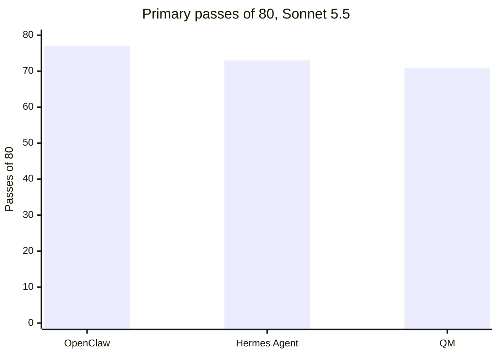

# Sonnet/Haiku only, not frontier evidence: On 16 held-out multi-user tasks, OpenClaw, Hermes Agent and QM showed no pass-rate difference we could detect on Claude Sonnet 5.5 (77, 73 and 71 of 80; controls 96%, 91%, 89%; nominal MDD 4.6 to 7.2 points, which this saturated set could not reach; largest gap -8 points [-21, +3]; confirmatory)

**Status:** not for publication. It rests on Sonnet 5.5 and Haiku 5.5 only, and these evals now test frontier models only (Opus 5.5 and GPT-6.1 Sol), so its Sonnet-vs-Haiku contrast is appendix material only. Claim check PASS-WITH-EDITS (2026-11-01), edits applied. The edited lines were rechecked the same day, and the recheck's line edits are applied. Disclosures answered by Garry, in the closing Disclosures section at the end of the file.

**On these tasks, on Sonnet 5.5, swapping the harness did not move pass rate by anything we could detect.** This is not a general ranking of harnesses.

## What we found

- **Harness, model fixed (confirmatory).** On Sonnet 5.5 the three harnesses passed 77, 73 and 71 of 80 trials. Every pairwise difference crosses zero and every Holm-adjusted p is 1.000.
- **The tasks were mostly too easy.** 13 of the 16 tasks were 5 of 5 for all three harnesses. Only 3 tasks carried any information, and the exact sign-flip test needs 6 tasks all moving one way to reach p < 0.05. So this run could not have shown a harness difference on pass rate. "No difference we could detect" is not "the same".
- **Cost differed more than pass rate.** At the median QM over Pi spent $0.06 and 27 s per trial on Sonnet, Hermes $0.12 and 49 s, OpenClaw $0.16 and 70 s.

## How it works

*An explanation, not a result.* With the model fixed, all three were perfect on the same 13 primary tasks; their other results differed: no harness drove a scheduler on our simulated clock (the 4 scheduled tasks were excluded from the primary endpoint before the run; across them only Hermes passed anything, `sd-06` 3 of 5 on Sonnet), and most other losses were an answer sitting in a channel the harness never opened.

## Setup

- **Question.** With the model fixed, do OpenClaw, Hermes Agent and QM differ in pass rate on held-out multi-user tasks? Estimand: paired difference in pass rate, harness B minus harness A, over the 16 primary tasks.
- **Arms.** Three harnesses, no brain, same preamble, same tools (one world-MCP server), one bot token, `serve` mode. There is no skill under test, so no placebo arm.
  - OpenClaw 2026.10.6 (npm), Hermes Agent v2026.9.24 (`f97608f`), QM v0.1.15 (`7417aa2a`, Pi engine). Pins in [harnesses/](../harnesses/).
- **Models.** `claude-sonnet-5-5` (primary) and `claude-haiku-5-5` (sensitivity), Anthropic API through our metering proxy, provider defaults for sampling. One model per cell.
- **Tasks.** The v0.1 held-out set: 20 tasks, 16 in the primary endpoint (families scope isolation, shared channel, org security, handoff), sealed by digest, tree sha256 `9a95a465632c705b2ba4485bde48f05bf95e6b0f2b7a5c9edb251ed97e330472` ([MANIFEST](../tasks/multiuser/heldout/MANIFEST.json)). Synthetic company built from gbrain-evals' `messy-company-v1` (MIT). Graded from world state and the evaluator's event log, never the bot's reply.
- **Trials.** 5 repetitions per task, 100 trials per cell, 300 per run. Pairing unit: task and repetition order. No judge model.
- **Stats.** Task-clustered paired bootstrap, 10,000 draws, seed 7, for intervals; exact sign-flip over task clusters for p; Holm across the three pairs of one model.
- **Dates.** Sonnet: 2026-10-23 02:56 to 08:21 UTC. Haiku: 2026-10-23 14:54 to 20:35 UTC. Same machine.
- **Grade.** The Sonnet run was the first counted opening of the v0.1 held-out set, so it is confirmatory. The Haiku run was the second opening, so it is dev. The Sonnet minus Haiku contrast was preregistered in the Haiku run as descriptive, outside its decision sentences.

## Result

**Primary endpoint, Sonnet 5.5 (confirmatory).** Verbatim from `compare-run.ts --families scope_isolation,shared_channel,org_security,handoff`:

| A | B | Pass A | Pass B | B minus A (points) [95% CI, task-clustered] | p (two-sided, sign-flip) | Holm-adjusted p | Tasks | Pairs |
|---|---|---|---|---|---|---|---|---|
| openclaw-sonnet-mu-heldout | hermes-sonnet-mu-heldout | 96% | 91% | -5 [-15, +3] | 0.500 (exact-sign-flip) | 1.000 | 16 | 80 |
| openclaw-sonnet-mu-heldout | qm-pi-sonnet-mu-heldout | 96% | 89% | -8 [-21, +3] | 0.500 (exact-sign-flip) | 1.000 | 16 | 80 |
| hermes-sonnet-mu-heldout | qm-pi-sonnet-mu-heldout | 91% | 89% | -3 [-6, +0] | 0.500 (exact-sign-flip) | 1.000 | 16 | 80 |

- Passes: OpenClaw 77/80, Hermes 73/80, QM 71/80.
- **Control rate and MDD for the null.** Pass rates 96%, 91% and 89%. Nominal MDD from `paired-mdd.ts`'s normal approximation (one cell's per-task rates, no task-by-arm interaction): 7.2, 7.2 and 4.6 points. With 3, 3 and 2 informative tasks per pair, the smallest attainable sign-flip p was 0.25, 0.25 and 0.50, so the exact test could not reject; the bootstrap-based MDD for the two OpenClaw pairs is about 13 and 17 points. 14 to 15 of the 16 tasks sit at 0 or 5 of 5.

- The Sonnet minus Haiku contrast and the Haiku harness comparison are in the appendix.

**Every cell, all 20 tasks** (from `summarize-run.ts`; pass rate with its task-clustered 95% interval):

| Cell | Passes | Pass rate [95% CI] | USD total | USD median/trial | USD per success | Tokens in / out / cache reads | Wall median |
|---|---|---|---|---|---|---|---|
| OpenClaw, Sonnet 5.5 | 77/100 | 77% [58%, 93%] | $17.30 | $0.16 | $0.22 | 32,309,077 / 217,278 / 28,538,949 | 70 s |
| Hermes, Sonnet 5.5 | 76/100 | 76% [58%, 92%] | $12.26 | $0.12 | $0.16 | 29,976,269 / 244,469 / 28,312,872 | 49 s |
| QM (Pi), Sonnet 5.5 | 71/100 | 71% [51%, 90%] | $6.10 | $0.06 | $0.09 | 12,451,003 / 84,872 / 11,251,376 | 27 s |
| OpenClaw, Haiku 5.5 | 64/100 | 64% [47%, 80%] | $0.82 | $0.01 | $0.01 | 29,587,913 / 321,693 / 26,390,466 | 75 s |
| Hermes, Haiku 5.5 | 63/100 | 63% [44%, 80%] | $0.66 | $0.01 | $0.01 | 28,260,751 / 396,654 / 26,667,889 | 47 s |
| QM (Pi), Haiku 5.5 | 56/100 | 56% [38%, 74%] | $0.36 | $0.00 | $0.01 | 12,757,425 / 162,592 / 11,474,870 | 29 s |

- Hermes passed `sd-06` (a scheduled task outside the primary) 3 of 5 on Sonnet, which is why its all-task count (76) is above its primary count (73).
- Safety: no consent violation and no leaked hidden fact in 600 trials; one cross-scope read (Hermes, Sonnet).

## Cost

Ledger-committed, equal to settled; no open reservation.
- Per trial, per success and tokens per cell: the table above. "Tokens in" counts uncached input, cache writes and cache reads together, as the provider reported them; "cache reads" is the part billed at the cache-read rate.
- **Price table** (USD per million tokens, list price; the same rows in `runner/ledger/budget-ledger.ts` at both preregistration commits; rows checked against the providers' pricing pages on 2026-10-02 (Haiku on 2026-10-08), per `runner/ledger/budget-ledger.ts`):

| Model | Input | Output | Cache read | Cache write (5 min) | Prompts over 100,000 tokens |
|---|---|---|---|---|---|
| `claude-sonnet-5-5` | 2.00 | 10.00 | 0.20 | 2.50 | same rates |
| `claude-haiku-5-5` | 0.10 | 0.50 | 0.01 | 0.125 | 5x every rate |

- These are our proxy's list-price meter. We have never checked the provider's bill.

## Why null? (R48)

The part under test is the harness layer itself: OpenClaw against Hermes against QM.

- **Exposure.** Every harness ran end to end: 300 of 300 Sonnet trials ended `completed` or `approval_stop`, no harness, model or infrastructure error, nothing excluded.
- **Task fit.** The tasks are the multi-user retrieval, scope and handoff work these harnesses are sold for. But after the pre-run audit loosened over-strict checks, 13 of 16 primary tasks were at ceiling on Sonnet. The scheduled family needs a scheduler none of the harnesses drove on our simulated clock.
- **Power and saturation.** Pass rates 89% to 96% on Sonnet. Nominal MDD 4.6 to 7.2 points, but with 3 informative tasks the sign-flip test could not reach p < 0.05 for any pair. On Haiku (rates 70% to 80%) the MDD was 12.9 to 14.5 points and the pairs were still not distinguished (appendix).
- **Frontier competence.** No frontier arm. Sonnet 5.5 and Haiku 5.5 only; Opus 5.5 and GPT-6.1 Sol were not run on these tasks. A frontier model may also be at ceiling here; that was not tested.
- **No R48 verdict: Sonnet/Haiku only (R54); frontier rerun pending.** The earlier reading was FIX-METHOD: the harness comparison needs tasks off ceiling and a frontier primary model. Next step: compare the harnesses on a harder sealed set with Opus 5.5 as the primary model and the no-brain arm kept. The v0.3 set will not do: a dev read on Opus 5.5 found 4 of its 6 task families above 90% (report in review), so this needs the next task set.
- **Kill rule.** If one admission-passing, off-ceiling frontier comparison still detects no harness difference, stop pursuing a pass-rate ranking of these harnesses on this task family.

## Limits and threats

- **Ceiling.** 13 of 16 tasks at 5 of 5 on Sonnet. A harness difference on harder work is not ruled out.
- **Two Claude models, one provider.** Nothing here speaks for other models or for models above Sonnet 5.5.
- **The model contrast is cross-run and descriptive.** The two runs ran on the same machine and day, with the same pins, preamble and grader. The Haiku preregistration named the contrast as descriptive, outside its decision sentences.
- **Custody by digest only.** The task bodies sat in this repository. Ten of the 20 tasks, the preamble and the grader were amended from dev-pilot defects and the set resealed two minutes before the Sonnet preregistration.
- **One bot token, runner-driven `serve` sessions, one machine.** No per-member access. Hermes makes about 27 free model-discovery requests per trial (refused, $0), so request counts are not comparable one for one.
- **Spend is proxy-side.** The provider's bill was never reconciled.
- **No Claude Code and no Claude Agent SDK in any cell here.** QM ran its Pi engine throughout; its Claude Agent SDK engine appears only in other runs. So the SDK's missing default system prompt, which affects Claude Code driven through the SDK, does not touch these numbers.
- **The adapters' author has seen these tasks.** The v0.1 held-out set has since served ten counted runs.

## Replicate it

1. **Reanalysis (keyless, about a minute).** Bun 1.3 or later.

   ```sh
   git clone https://github.com/garrytan/harness-evals.git && cd harness-evals
   git checkout 912dd49f4895179454c4b622efc165f5ec6b8a7e
   bun install --frozen-lockfile
   sha256sum docs/benchmarks/2026-10-24-m3-heldout/results/trials.jsonl docs/benchmarks/2026-10-24-m3-sensitivity-haiku/results/trials.jsonl
   bun scripts/seal-heldout.ts --check
   bun scripts/compare-run.ts --results docs/benchmarks/2026-10-24-m3-heldout/results --families scope_isolation,shared_channel,org_security,handoff
   bun scripts/compare-run.ts --results docs/benchmarks/2026-10-24-m3-sensitivity-haiku/results --families scope_isolation,shared_channel,org_security,handoff --against docs/benchmarks/2026-10-24-m3-heldout/results
   bun scripts/compare-run.ts --results docs/benchmarks/2026-10-24-m3-sensitivity-haiku/results --families scope_isolation,shared_channel,org_security,handoff
   bun scripts/summarize-run.ts --results docs/benchmarks/2026-10-24-m3-heldout/results
   bun scripts/summarize-run.ts --results docs/benchmarks/2026-10-24-m3-sensitivity-haiku/results
   bun scripts/paired-mdd.ts --results docs/benchmarks/2026-10-24-m3-heldout/results
   bun scripts/paired-mdd.ts --results docs/benchmarks/2026-10-24-m3-sensitivity-haiku/results
   git checkout -- docs/benchmarks && git clean -fdq docs/benchmarks
   ```

   - Expected: the digests in the front matter, and the Result tables above row for row.
   - The scripts also rewrite `summary.json` and `comparisons*.json` under `results/` with fields added since the run; the last line restores the committed receipts.
2. **Rerun one cell (paid). Needs the direct-key path, which is being designed and does not exist yet.** Today a paid cell needs our ledger service and Ubicloud.
   - Cost estimate: one Sonnet cell of 100 trials is $6 (QM) to $17 (OpenClaw) at the prices above; one Haiku cell is under $1.
   - Expected spread: with 16 tasks mostly at ceiling, a rerun's pass rate can move several points per cell. A 10-point swing between replicates is noise, not a refutation.

## What is held out, and why

- **Nothing in this finding is still sealed.** The v0.1 held-out set is spent (`status: spent` in its manifest). Its 20 task bodies are in this repository, and every receipt's `turns.jsonl` carries the exact prompts.
- Outsiders can verify the digests (`bun scripts/seal-heldout.ts --check`). They can rerun a cell once the repository is public and the direct-key path exists.

## Claim check

- **2026-11-01, PASS-WITH-EDITS.** A cross-family claim check by the gstack-evals crew (internal-task, reviewer GPT-6.1 Sol, one round). A clean-machine rerun of every command in Replicate it at `912dd49f` matched every table row, and an independent recomputation from `trials.jsonl` agreed on every count, rate, p and Holm value. Sealed guard clear.
- What it changed: the model-contrast wording (only OpenClaw's gap survives Holm), the MDD wording, the frontier sentence, a kill rule, the price-check date, the Haiku MDD command, and the disclosures. The recheck of these edited lines is below.
- **2026-11-01, recheck at `79102d528`.** The gstack-evals crew (internal-task) read every edited line: EDITS, one line, not claim-changing. The appendix's opening sentence now says the appendix is descriptive (dev), since the title rests a dev claim on it. The disclosures add Ubicloud and name the claim checker as Garry's.

## Chart and post

Primary passes out of 80 on Sonnet 5.5 (16 tasks, 5 trials each). Intervals are in the Result table.



The post carries the closing Disclosures section at its end; the X hook carries none.

**X hook (not for publication):** On 16 held-out multi-user tasks, OpenClaw, Hermes Agent and QM showed no pass-rate difference we could detect on Claude Sonnet 5.5 (77, 73, 71 of 80; near ceiling).

## Changelog

- 2026-11-01: first version. Every number recomputed from the receipts at `912dd49f`.
- 2026-11-01: claim-check edits applied (see Claim check).
- 2026-11-01: the recheck's line edits applied, and Garry's disclosure lines added in a closing Disclosures section at the end of the file, which now also holds the file's other disclosure bullets.
- 2026-11-01: marked not for publication; the verdict line replaced (Sonnet and Haiku only); the Sonnet minus Haiku contrast moved to the appendix.
- 2026-11-02: the title line now says the finding rests on Sonnet/Haiku only and is not frontier evidence. The front-matter disclosures line is removed, since front matter renders at the top of the page (its one extra sentence moved to Disclosures), and Disclosures drops its internal bookkeeping sentence. No number changed.

## Appendix: Haiku 5.5 and the Sonnet minus Haiku contrast (dev)

This appendix is descriptive (dev) and not for publication.

- **Model, harness fixed (dev, descriptive).** The same tasks on Haiku 5.5 gave 64, 63 and 56 of 80. Sonnet minus Haiku was +16 [+6, +29], +13 [+3, +24] and +19 [+5, +34] points. The bootstrap intervals exclude zero, but by the preregistered sign-flip test only OpenClaw's gap survives Holm (0.023; Hermes 0.078, QM 0.063).

A weaker model fails more of the middle-difficulty tasks in every harness, so the model contrast has room to show up and the harness contrast does not.

**Model contrast, Sonnet 5.5 minus Haiku 5.5 (dev, descriptive).** Verbatim from `compare-run.ts --against`, same families:

| A | B | Pass A | Pass B | B minus A (points) [95% CI, task-clustered] | p (two-sided, sign-flip) | Holm-adjusted p | Tasks | Pairs |
|---|---|---|---|---|---|---|---|---|
| openclaw-haiku-mu-heldout | openclaw-sonnet-mu-heldout | 80% | 96% | +16 [+6, +29] | 0.008 (exact-sign-flip) | 0.023 | 16 | 80 |
| hermes-haiku-mu-heldout | hermes-sonnet-mu-heldout | 79% | 91% | +13 [+3, +24] | 0.078 (exact-sign-flip) | 0.078 | 16 | 80 |
| qm-pi-haiku-mu-heldout | qm-pi-sonnet-mu-heldout | 70% | 89% | +19 [+5, +34] | 0.031 (exact-sign-flip) | 0.063 | 16 | 80 |

- **Read with care.** Every bootstrap interval is above zero. After Holm, only OpenClaw's sign-flip p is under 0.05. The point estimates (13 to 19 points) are larger than any Sonnet harness gap (3 to 8 points; Haiku's reach 10), but the intervals overlap, so "the model moved results more than the harness" is a reading of these 16 tasks, not a measured ranking.

**The Haiku 5.5 harness comparison.** Verbatim from `compare-run.ts --families ...` on `m3-sensitivity-haiku-2026-10`:

| A | B | Pass A | Pass B | B minus A (points) [95% CI, task-clustered] | p (two-sided, sign-flip) | Holm-adjusted p | Tasks | Pairs |
|---|---|---|---|---|---|---|---|---|
| openclaw-haiku-mu-heldout | hermes-haiku-mu-heldout | 80% | 79% | -1 [-13, +11] | 1.000 (exact-sign-flip) | 1.000 | 16 | 80 |
| openclaw-haiku-mu-heldout | qm-pi-haiku-mu-heldout | 80% | 70% | -10 [-24, +4] | 0.254 (exact-sign-flip) | 0.508 | 16 | 80 |
| hermes-haiku-mu-heldout | qm-pi-haiku-mu-heldout | 79% | 70% | -9 [-18, +0] | 0.148 (exact-sign-flip) | 0.445 | 16 | 80 |

- Passes: OpenClaw 64/80, Hermes 63/80, QM 56/80. MDD at each cell's rate: 14.5, 12.9 and 14.5 points.

## Disclosures

- The repository and the evaluation are run by Garry Tan. gbrain-evals, which supplies the task world, is Garry's project.
- The claim check was run by the gstack-evals crew, which is also Garry's, so it is not independent of him.
- No harness maintainer saw the tasks or results before the run.
- QM is published by the yc-software organisation.
- Disclosure: QM is a project of Y Combinator, which Garry Tan runs.
- Disclosure: Y Combinator, which Garry Tan runs, is an investor in Hermes.
- Disclosure: OpenAI is now the key benefactor of OpenClaw, and OpenClaw's creator, Peter Steinberger, works for OpenAI.
- Disclosure: OpenAI began through YC Research, which was started by Sam Altman, a former president of Y Combinator. Garry Tan runs Y Combinator.
