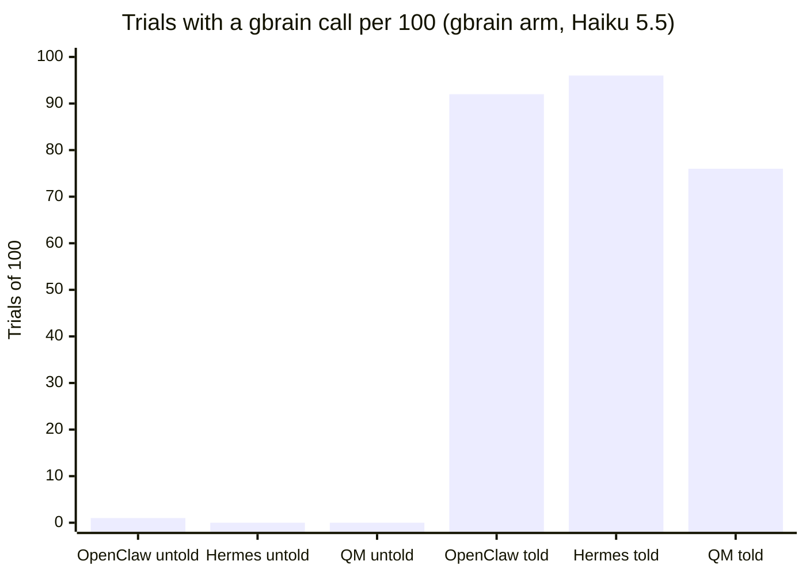

# Sonnet/Haiku only, not frontier evidence: Installed as an MCP server and never mentioned, gbrain was called in 4 of 799 scored trials (0.5%, 95% CI 0.2% to 1.3%) across OpenClaw, Hermes Agent and QM on Claude Sonnet 5.5 and Haiku 5.5 (dev), and pass rate showed no change we could detect (untold minus none -6 to +8 points, every interval touching or crossing zero; none-cell controls 69% to 99%; nominal MDD 4.6 to 16.5 points)

**Status:** dev background for the Opus 5.5 reruns in internal-task-a's v0.4 and internal-task-b's H10, not for publication on its own: it rests on Sonnet 5.5 and Haiku 5.5 only. Claim check PASS-WITH-EDITS (2026-11-01), edits applied. The edited lines were rechecked the same day, and the recheck's line edits are applied. Disclosures answered by Garry, in the closing Disclosures section at the end of the file.

**If you install gbrain's MCP server beside a harness and don't tell the harness to use it, it was called in 4 of 799 scored trials.** Registration can still change what the model sees without a call. This is a dev result on two Claude models and one task set, and it does not show gbrain is useless: told, the same harnesses used it in 76% to 96% of trials.

## What we found

- **Use.** With gbrain registered and nothing said about it, a harness called a gbrain tool in 2 of 600 trials in the gbrain arm and 2 of 199 scored trials on the install ladder's `mcp` rung (one OpenClaw trial there ended `model_error`, made no gbrain call and is excluded). Four of the six harness-model cells in the arm never called it at all.
- **Pass rate.** gbrain minus no-gbrain on the 16 primary tasks ran from -6 to +8 points; every interval touches or crosses zero and every Holm-adjusted p is 0.75 or more. Only one of the 600 untold arm trials retrieved gbrain content and one other made a write, so a pass difference here is unlikely to come from what gbrain returned; registration itself can still change behavior.
- **The told arm is the positive control.** One brain-first sentence in the per-turn preamble turned use on in 76% to 96% of scored trials in the same runs.
- **The same thing happened to gstack's skills.** In gstack-evals' Lane B quick look 1, agents invoked a gstack skill 0 times in the 180 untold gstack-arm trials (540 trials in all) on 20 Terminal-Bench 2 tasks ([gstack-evals results post at `5a5192ff`](https://github.com/garrytan/gstack-evals/blob/5a5192ffa8db22626fdf4e98926eb62a29ca0439/wiki/board/2026-10-29-gsta-12-laneb-quick-results/README.md)). Untold tools went unused in both projects. One caveat on that run: it drove Claude Code through the Claude Agent SDK with no system prompt set, so the model got a two-line stub instead of Claude Code's own guidance, which includes how to invoke a skill; gstack-evals is rerunning its key reads with Claude Code's own prompt.

## How it works

*An explanation, not a result.* Later keyless captures of each harness's first model request (in [docs/harness-anatomy/](../docs/harness-anatomy/README.md)) show how little of gbrain the model sees when nobody mentions it:

- **OpenClaw** puts no gbrain name in the request. Registering gbrain only changes "15 additional tools omitted" to "50"; the model can reach gbrain only through `tool_search` or by guessing a name ([openclaw.md](../docs/harness-anatomy/openclaw.md)).
- **Hermes Agent** puts every MCP tool behind `tool_search`. gbrain adds one line per tool inside that tool's description ([hermes.md](../docs/harness-anatomy/hermes.md)).
- **QM** lists every gbrain tool in its system prompt's Connectors section in a later-pin capture ([qm.md](../docs/harness-anatomy/qm.md)); exposure in the counted runs was not recorded. QM made no gbrain call in its 200 untold trials, which fits the reading that seeing the tools is not enough, though this run did not test it.

These captures were taken at later pins than the runs (QM at `b6786d67`, not v0.1.15), so they explain the result; they are not its evidence.

## Setup

- **Question.** Does installing gbrain's MCP server, with no instruction to use it, change what a harness does? Estimand: per cell, the share of trials with at least one gbrain `tools/call`; secondary, paired pass difference untold minus none over the 16 primary tasks.
- **Arms.** `none` (no gbrain); untold (gbrain registered as a second MCP server, preamble unchanged; the arm's `gbrain` cells and the ladder's `mcp` rung); `told` (the same plus a brain-first clause in the per-turn preamble), the positive control.
- **Harnesses.** OpenClaw 2026.10.6, Hermes Agent v2026.9.24, QM v0.1.15 (Pi). The ladder ran OpenClaw and Hermes only.
- **Models.** `claude-sonnet-5-5` and `claude-haiku-5-5` through the metering proxy. The ladder is Haiku only.
- **gbrain.** Starter surface, 33 tools, keyword search, one bot-wide token over the bot-visible brain. Arm: `f241216c` (0.60.413.0). Ladder: `089bf0d848b5` (0.60.431.0).
- **Tasks.** The v0.1 held-out set (20 tasks, 16 primary), tree sha256 `9a95a465632c705b2ba4485bde48f05bf95e6b0f2b7a5c9edb251ed97e330472`. The arm was its third counted opening and the ladder its sixth, so both are dev.
- **Trials.** 5 repetitions per task, 100 trials per cell. Arm: 15 cells, 1,500 trials, 2026-10-24 01:24 to 2026-10-25 01:01 UTC. Ladder: 14 cells, 1,400 trials (1,391 scored), 2026-10-24 23:49 to 2026-10-25 05:46 UTC.
- **Measurement.** The world server's gbrain tap logs every `initialize`, `tools/list` and `tools/call` with its arguments and the pages returned ([docs/gbrain-arm.md](../docs/gbrain-arm.md)). Use is read from that log, not from the harness's account.
- **Stats.** Use: counts with Wilson 95% intervals. Pass: task-clustered paired bootstrap (10,000 draws, seed 7), exact sign-flip, Holm within model.

## Result

**Use, untold cells** (from `summarize-run.ts`; "listed tools" means the harness fetched gbrain's `tools/list` in that trial):

| Run | Harness | Model | Trials with a gbrain call | Wilson 95% CI | Trials that listed gbrain's tools | Calls |
|---|---|---|---|---|---|---|
| gbrain-arm | OpenClaw | Haiku 5.5 | 1 / 100 | 0.2% to 5.4% | 100 | `entity` 1, `get_page` 1 |
| gbrain-arm | Hermes | Haiku 5.5 | 0 / 100 | 0% to 3.7% | 100 | none |
| gbrain-arm | QM | Haiku 5.5 | 0 / 100 | 0% to 3.7% | 99 | none |
| gbrain-arm | OpenClaw | Sonnet 5.5 | 1 / 100 | 0.2% to 5.4% | 100 | `remember` 1 (a write) |
| gbrain-arm | Hermes | Sonnet 5.5 | 0 / 100 | 0% to 3.7% | 100 | none |
| gbrain-arm | QM | Sonnet 5.5 | 0 / 100 | 0% to 3.7% | 99 | none |
| ladder `mcp` | OpenClaw | Haiku 5.5 | 2 / 99 | 0.6% to 7.1% | 99 | `search` 2 |
| ladder `mcp` | Hermes | Haiku 5.5 | 0 / 100 | 0% to 3.7% | 100 | none |
| **All untold** | | | **4 / 799** | **0.2% to 1.3%** | 797 | |

- Scored trials only: the one ladder OpenClaw trial that ended `model_error` (`sd-06` r3) is excluded; it listed gbrain's tools and called none. The two QM `harness_error` trials in the untold cells count, as the arm's preregistration says; they listed no tools, which is why 797 of 799 listed them.
- **Positive control, told cells, same runs:** 92, 96 and 76 of 100 (arm, Haiku: OpenClaw, Hermes, QM); 89 of 99 scored and 94 of 100 (ladder: OpenClaw, Hermes; the OpenClaw told cell's one `model_error` trial, `sd-04` r3, is excluded the same way).

**Pass, untold minus none, gbrain arm, 16 primary tasks.** Verbatim rows from `compare-run.ts --pair gbrain --families scope_isolation,shared_channel,org_security,handoff` (untold cells only; the script's sensitivity rows equal these):

| Harness | Model | gbrain cell | Passed none | Passed gbrain | gbrain minus none (points) [95% CI, task-clustered] | p (two-sided, sign-flip) | Holm-adjusted p | Tasks | Pairs |
|---|---|---|---|---|---|---|---|---|---|
| openclaw | anthropic:claude-haiku-5-5 | `openclaw-haiku-gbrain-mu-heldout` | 55 / 80 | 57 / 80 | +3 [-6, +13] | 0.844 (exact-sign-flip) | 1.000 | 16 | 80 |
| hermes | anthropic:claude-haiku-5-5 | `hermes-haiku-gbrain-mu-heldout` | 63 / 80 | 64 / 80 | +1 [-9, +13] | 1.000 (exact-sign-flip) | 1.000 | 16 | 80 |
| qm pi | anthropic:claude-haiku-5-5 | `qm-pi-haiku-gbrain-mu-heldout` | 60 / 80 | 62 / 80 | +3 [-4, +9] | 0.688 (exact-sign-flip) | 1.000 | 16 | 80 |
| openclaw | anthropic:claude-sonnet-5-5 | `openclaw-sonnet-gbrain-mu-heldout` | 73 / 80 | 79 / 80 | +8 [+0, +19] | 0.250 (exact-sign-flip) | 0.750 | 16 | 80 |
| hermes | anthropic:claude-sonnet-5-5 | `hermes-sonnet-gbrain-mu-heldout` | 79 / 80 | 77 / 80 | -3 [-9, +3] | 0.750 (exact-sign-flip) | 0.750 | 16 | 80 |
| qm pi | anthropic:claude-sonnet-5-5 | `qm-pi-sonnet-gbrain-mu-heldout` | 72 / 80 | 67 / 80 | -6 [-14, +0] | 0.250 (exact-sign-flip) | 0.750 | 16 | 80 |

**Pass, `mcp` rung minus none, ladder** (Haiku). Verbatim from `compare-run.ts --pair gbrain`:

| Harness | Model | Comparison | Positive base | Positive rung | rung minus base (points) [95% CI, task-clustered] | p (two-sided, sign-flip) | Holm-adjusted p (family) | Tasks | Pairs | Excluded |
|---|---|---|---|---|---|---|---|---|---|---|
| openclaw | anthropic:claude-haiku-5-5 | mcp vs none | 62 / 79 | 60 / 80 | -4 [-16, +6] | 0.625 (exact-sign-flip) | 1.000 (6) | 16 | 79 | 1 |
| hermes | anthropic:claude-haiku-5-5 | mcp vs none | 65 / 80 | 65 / 80 | +0 [-10, +10] | 1.000 (exact-sign-flip) | 1.000 (6) | 16 | 80 | 0 |
| openclaw | anthropic:claude-haiku-5-5 | mcp vs none | 62 / 99 | 60 / 99 | -3 [-13, +5] | 0.625 (exact-sign-flip) | 1.000 (6) | 20 | 98 | 2 |
| hermes | anthropic:claude-haiku-5-5 | mcp vs none | 65 / 100 | 65 / 100 | +0 [-8, +8] | 1.000 (exact-sign-flip) | 1.000 (6) | 20 | 100 | 0 |

- The first two rows are the 16 primary tasks, the last two all 20 tasks. One OpenClaw trial per cell ended `model_error` and is excluded, with its pair.
- **Control rates and MDD for the null** (none cells, 16 primary tasks, `paired-mdd.ts`): Haiku 69%, 79%, 75% with MDD 12.9, 11.7 and 16.5 points; Sonnet 91%, 99%, 90% with MDD 8.6, 4.6 and 5.6 points (OpenClaw, Hermes, QM). The Sonnet cells are near ceiling: 13 to 15 of 16 tasks at 0 or 5 of 5.
- **Ladder controls and MDD** (none cells, 16 primary tasks, `paired-mdd.ts` on the ladder results): 78% (OpenClaw) and 81% (Hermes), nominal MDD 14.5 and 14.1 points.
- **The MDDs are nominal.** They come from `paired-mdd.ts`'s normal approximation (one cell's per-task rates, no task-by-arm interaction). Each Sonnet pair had 3 informative tasks, so the smallest attainable sign-flip p was 0.25 and the exact test could not reject; bootstrap-based MDDs for the Sonnet pairs are about 14, 8 and 10 points.
- No cross-scope read through gbrain in any untold MCP-only cell (the Hermes `docs-semantic` search below made one).

**The ladder's docs rungs** (Haiku 5.5, preamble unchanged, gbrain installed the way gbrain's own docs say for each harness: scaffolded skills for OpenClaw, scaffolded skills plus an always-loaded `.hermes.md` context file for Hermes; `docs` uses keyword search, `docs-semantic` semantic search with `openai:text-embedding-3-small` embeddings; from `summarize-run.ts`, every trial scored):

| Rung | Harness | Trials with a gbrain call | Wilson 95% CI | Calls |
|---|---|---|---|---|
| `docs` | OpenClaw | 0 / 100 | 0% to 3.7% | none |
| `docs-semantic` | OpenClaw | 0 / 100 | 0% to 3.7% | none |
| `docs` | Hermes | 1 / 100 | 0.2% to 5.4% | `search` 1 |
| `docs-semantic` | Hermes | 1 / 100 | 0.2% to 5.4% | `search` 1 |

- 0 to 1 gbrain calls per 100 trials, the same floor as the MCP-only route. The one Hermes `docs-semantic` search returned a page from a channel the asker is not in, so that cell has one cross-scope read through gbrain. These are the routes gbrain's own docs tell a user to run, but they ran on the starter surface instead of the full surface those docs register and left out OpenClaw's first documented shape (the context-engine plugin), so they are not exactly what real users get and the cut does not extend to them.

## Cost

- **QM's input tokens rose 57% in both untold cells** (Sonnet 12.5 to 19.6 million, Haiku 12.2 to 19.2 million, over 100 trials and all 20 tasks). The tool list is a likely cause; this run did not isolate it. OpenClaw and Hermes moved -1% to +7%, consistent with gbrain's names sitting behind `tool_search`.
- **Untold cells, all 20 tasks** (from `summarize-run.ts`):

| Cell | USD total, none / untold | USD per success, none / untold | Tokens in (none / untold) | Wall median, none / untold |
|---|---|---|---|---|
| OpenClaw, Sonnet 5.5 | $17.49 / $18.03 | $0.24 / $0.23 | 32.0M / 34.2M | 65 s / 78 s |
| Hermes, Sonnet 5.5 | $12.55 / $12.30 | $0.15 / $0.16 | 30.8M / 31.6M | 45 s / 49 s |
| QM, Sonnet 5.5 | $6.09 / $7.44 | $0.08 / $0.11 | 12.5M / 19.6M | 25 s / 28 s |
| OpenClaw, Haiku 5.5 | $0.85 / $0.77 | $0.02 / $0.01 | 28.0M / 27.6M | 68 s / 78 s |
| Hermes, Haiku 5.5 | $0.63 / $0.65 | $0.01 / $0.01 | 27.7M / 28.2M | 41 s / 48 s |
| QM, Haiku 5.5 | $0.35 / $0.41 | $0.01 / $0.01 | 12.2M / 19.2M | 26 s / 31 s |
| OpenClaw, Haiku 5.5 (ladder) | $0.76 / $0.77 | $0.01 / $0.01 | 27.0M / 27.1M | 66 s / 78 s |
| Hermes, Haiku 5.5 (ladder) | $0.64 / $0.66 | $0.01 / $0.01 | 28.2M / 29.0M | 44 s / 50 s |

- **Run totals (every cell, told and other rungs included):** gbrain arm $80.87 committed, of which $0.79 is two reservations left open ($80.08 settled on 12,972 entries); ladder $11.53 committed on 13,956 requests ($10.73 counted plus $0.80 on an aborted shard). Ledger-committed, proxy list price, never checked against the provider's bill.
- "Tokens in" counts uncached input, cache writes and cache reads together.
- **Price table** (USD per million tokens, the same rows in `runner/ledger/budget-ledger.ts` at both preregistration commits; rows checked against the providers' pricing pages on 2026-10-02 (Haiku on 2026-10-08), per `runner/ledger/budget-ledger.ts`):

| Model | Input | Output | Cache read | Cache write (5 min) | Prompts over 100,000 tokens |
|---|---|---|---|---|---|
| `claude-sonnet-5-5` | 2.00 | 10.00 | 0.20 | 2.50 | same rates |
| `claude-haiku-5-5` | 0.10 | 0.50 | 0.01 | 0.125 | 5x every rate |

## Why null? (R48)

The part under test is the untold install: gbrain registered beside the harness with no instruction to use it.

- **Exposure.** The harness side ran: 797 of 799 scored untold trials fetched gbrain's `tools/list` (the tap's log). The model side is weak by design of two harnesses: OpenClaw's first request names no gbrain tool and Hermes's names them only inside `tool_search` (later keyless captures, How it works). QM's later-pin capture lists every gbrain tool; exposure in the counted runs was not recorded, and QM made no gbrain call in its 200 untold trials. The run receipts keep no request bodies, so exposure to the model in the counted trials is inferred from those captures, not measured.
- **Task fit.** Yes for part of the set. The told arm gained the cross-channel retrieval tasks the none cells failed, so gbrain had something to offer on these tasks when it was used.
- **Power and saturation.** For use, 0 to 2 calls per 100 trials is a floor, and the told control shows the measure can move. For pass, nominal Haiku MDD 11.7 to 16.5 points; Sonnet 4.6 to 8.6 points, near ceiling (bootstrap-based, about 8 to 14).
- **Frontier competence.** No frontier arm: Sonnet 5.5 and Haiku 5.5 only. The instruction-route run (dev, Haiku) had the same shape in its no-instruction control (1 of 160 and 0 of 160 turns checked gbrain); its frontier rerun, planned by another lane, carries that control on Opus 5.5.
- **No R48 verdict: Sonnet/Haiku only (R54); frontier rerun pending.** The earlier reading was CUT-CANDIDATE for gbrain's untold, MCP-only install route. It delivered 4 uses in 799 scored trials on these harnesses and models, and on QM it cost 57% more input tokens. The cut waits for a frontier no-instruction control: this is dev-grade data on two Claude models, and it does not show gbrain is useless. Keep gbrain itself: a told clause or a per-turn hook turns use on (the revised installer with its hook reached 80 of 80 trials; its wording, hook and gbrain pin changed together). The docs rungs were also at 0 to 1 calls per 100 trials (Result). These are the routes gbrain's own docs tell a user to run, but they ran on the starter surface instead of the full surface those docs register and left out OpenClaw's first documented shape (the context-engine plugin), so they are not exactly what real users get and the cut does not extend to them.
- **Next step, a frozen rule.** If the Opus 5.5 no-instruction control, on the same documented MCP-only route with a working told control, also shows near-zero use (threshold frozen before that run), drop the bare route from gbrain's install docs. Otherwise keep it and fix discovery.

## Limits and threats

- **Dev, not confirmatory.** Both runs reopened a held-out set whose earlier results were known.
- **Two Claude models.** No frontier model, no other provider.
- **Use is measured; exposure to the model is inferred** from later captures at newer pins.
- **The Sonnet arm mixes machines with harnesses.** Each harness's Sonnet cells ran on their own machine, so comparisons across harnesses carry the machine; each untold-versus-none pair shared one. Three QM trials in the gbrain arm (one Sonnet, two Haiku) ended `harness_error` (QM's core could not bind port 58080 because the previous trial's stack had not released it, per the run report) and count as failures; excluding them changes no sentence.
- **Starter surface, keyword search, one bot-wide token** (the `docs-semantic` rung used semantic search). Other gbrain surfaces and scopes were measured in other runs and are not part of this claim.
- **Spend is proxy-side.**
- **No Claude Code and no Claude Agent SDK in any cell here.** QM ran its Pi engine throughout; its Claude Agent SDK engine appears only in other runs. So the SDK's missing default system prompt, which affects Claude Code driven through the SDK, does not touch these numbers.

## Replicate it

1. **Reanalysis (keyless, a few minutes).** Bun 1.3 or later.

   ```sh
   git clone https://github.com/garrytan/harness-evals.git && cd harness-evals
   git checkout 912dd49f4895179454c4b622efc165f5ec6b8a7e
   bun install --frozen-lockfile
   sha256sum docs/benchmarks/2026-10-24-gbrain-arm/results/trials.jsonl docs/benchmarks/2026-10-25-gbrain-ladder/results/trials.jsonl
   bun scripts/seal-heldout.ts --check
   bun scripts/summarize-run.ts --results docs/benchmarks/2026-10-24-gbrain-arm/results
   bun scripts/summarize-run.ts --results docs/benchmarks/2026-10-25-gbrain-ladder/results
   bun scripts/compare-run.ts --results docs/benchmarks/2026-10-24-gbrain-arm/results --pair gbrain --families scope_isolation,shared_channel,org_security,handoff
   bun scripts/compare-run.ts --results docs/benchmarks/2026-10-25-gbrain-ladder/results --pair gbrain
   bun scripts/paired-mdd.ts --results docs/benchmarks/2026-10-24-gbrain-arm/results
   bun scripts/paired-mdd.ts --results docs/benchmarks/2026-10-25-gbrain-ladder/results
   git checkout -- docs/benchmarks && git clean -fdq docs/benchmarks
   ```

   - Expected: the digests in the front matter, and the Result tables above row for row (use counts are the "Trials with gbrain calls" column of `summarize-run.ts`'s gbrain table). One exception: `summarize-run.ts` counts every trial, so on the ladder OpenClaw rows it reports 100, not 99, listed-tools trials and told calls of 90, not 89; the tables drop the one `model_error` trial in each cell by hand, as the note under the first table says.
   - The scripts rewrite `summary.json` and `comparisons*.json` under `results/` with fields added since the runs; the last line restores the committed receipts.
2. **Rerun one cell (paid). Needs the direct-key path, which is being designed and does not exist yet.** Today a paid cell needs our ledger service and Ubicloud, plus a gbrain sidecar image built at the run's commit (`bun scripts/gbrain-check.ts` builds it, keyless).
   - Cost estimate: one untold Haiku cell of 100 trials is under $1; one untold Sonnet cell is $7 (QM) to $18 (OpenClaw).
   - Expected spread: a use count of 0 to 3 in 100 is the same result. A pass swing of 10 points on 16 tasks is noise.

## What is held out, and why

- **Nothing in this finding is still sealed.** The v0.1 held-out set is spent; its task bodies are in this repository and every receipt's `turns.jsonl` carries the exact prompts.
- Outsiders can verify the digests (`bun scripts/seal-heldout.ts --check`) and rerun a cell once the repository is public and the direct-key path exists.

## Claim check

- **2026-11-01, PASS-WITH-EDITS.** A cross-family claim check by the gstack-evals crew (internal-task, reviewer GPT-6.1 Sol, one round). A clean-machine rerun of every command in Replicate it at `912dd49f` matched every table row, and an independent recomputation from `trials.jsonl` and the tap logs agreed on every count, rate, p and Holm value. Sealed guard clear.
- What it changed: the causal and exposure wording, the two cost percentages (they had mixed in told cells), the ladder controls and MDDs, the MDD caveat, the run total's open reservations, the frozen next-step rule, the price-check date and the disclosures. The docs rungs were added on the coordinating agent's ruling. The recheck of these edited lines is below.
- **2026-11-01, recheck at `79102d528`.** The gstack-evals crew (internal-task) read every edited line and recomputed every new count: EDITS, two lines. The H1 now names the MCP-server route, since the 4 of 799 counts only that route. The X hook said "called 4 times"; gbrain was called 5 times in 4 trials, so it now says "called in 4". The disclosures add Ubicloud and Capy and name the claim checker as Garry's.

## Chart and post

Trials with a gbrain call, per 100, gbrain arm on Haiku 5.5: untold (installed, never mentioned) against told (one brain-first sentence). Intervals are in the Result tables.



The post carries the closing Disclosures section at its end; the X hook carries none.

**X hook (not for publication):** We installed gbrain's MCP server beside OpenClaw, Hermes Agent and QM and said nothing about it. Across 799 scored trials on Claude Sonnet 5.5 and Haiku 5.5 it was called in 4. On Haiku, one sentence telling the harness to use it: 76% to 96% of trials. (dev, two Claude models)

## Changelog

- 2026-11-01: first version. Every number recomputed from the receipts at `912dd49f`.
- 2026-11-01: claim-check edits applied (see Claim check), the docs rungs added, and the cut scoped to the untold MCP-only route.
- 2026-11-01: the recheck's line edits applied, and Garry's disclosure lines added in a closing Disclosures section at the end of the file, which now also holds the file's other disclosure bullets.
- 2026-11-01: marked dev background for the Opus 5.5 reruns; the verdict line replaced (Sonnet and Haiku only).
- 2026-11-02: the title line now says the finding rests on Sonnet/Haiku only and is not frontier evidence. The front-matter disclosures line is removed, since front matter renders at the top of the page, and Disclosures drops its internal bookkeeping sentence. No number changed.
- 2026-11-04: internal role names replaced with plain ones (the coordinating agent, the project's private drive, agent threads); no number, link or claim changed, because the public export blocks internal role names in prose.

## Disclosures

- The repository and the evaluation are run by Garry Tan. gbrain and gstack (cited in What we found) are his own projects, and gbrain-evals, which supplies the task world, is too.
- The claim check was run by the gstack-evals crew, which is also Garry's, so it is not independent of him.
- The install ladder ran on Capy machines (the ladder report).
- QM is published by the yc-software organisation.
- Disclosure: QM is a project of Y Combinator, which Garry Tan runs.
- Disclosure: Y Combinator, which Garry Tan runs, is an investor in Hermes.
- Disclosure: OpenAI is now the key benefactor of OpenClaw, and OpenClaw's creator, Peter Steinberger, works for OpenAI.
- Disclosure: OpenAI began through YC Research, which was started by Sam Altman, a former president of Y Combinator. Garry Tan runs Y Combinator.
- gbrain is Garry Tan's own project.
- gstack is Garry Tan's own project.
