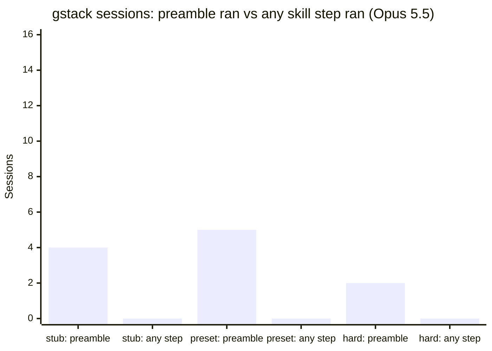

# Told to run gstack's /investigate, /qa, /review or /ship, Claude Opus 5.5 loaded the skill text every time and ran none of its steps: 0 of 46 gstack sessions across three uncounted checks (deciding check 0 of 16, Wilson 95% upper bound 0.194), at about twice the cost per trial of no gstack

**Status:** draft, not posted. Claim check PASS-WITH-EDITS (2026-11-02), edits applied; the recheck of the edited lines passed the same day. Opus 5.5 only: no GPT-6.1 Sol arm ran.

**gstack's skill text reached Opus 5.5 in every session, and Opus did not run its steps.** In 46 gstack sessions across three checks, no session ran a single step of the skill it was told to use. The checks are small and their tasks were easy for Opus 5.5, so this says the steps were not followed, not that following them would or would not help.

## What we found

- **The skill loaded every time.** gstack's router and the invoked skill were listed in all 48 gstack sessions, and the body-load gate passed at a rate of 1 in all three runs.
- **No step ran, on any of the four skills.** 0 of 46 gstack sessions ran a skill step: no section-file read, no Skill tool call, no skill report. That is 0 of 30 with Claude Code's own system prompt, and `/investigate` is 0 of 22.
- **What ran instead was the top of the skill.** The preamble that opens every skill ran in 4, 5 and 2 sessions in the three runs, by the probe's count. A third hard-run session called gstack's start helper but piped it through `head -5`, which cut off the lines the probe looks for. Then the model did an ordinary fix, review or push.
- **The deciding check said STOP, on easy tasks.** With Claude Code's own system prompt, followed was 0 of 16 (Wilson 95% [0, 0.194]), under the run's frozen STOP line of 0.60. But every arm passed 14 of 16 of these dev tasks.
- **The hard-task check is VOID.** On 8 SWE-bench Verified bugs the no-gstack arm passed 8 of 8, over the rule's void line of 4. So its 0 of 14 is descriptive, and "is the skill followed when the task is hard?" is still untested.
- **gstack's mean cost per trial was about 2 times no gstack's** in every run (1.99, 2.25 and 2.11 times; point estimates, no interval computed). Every request carried the skill text, and the median first request was about 14,000 to 20,000 tokens larger.

## How it works

*An explanation, not a result.* A gstack skill is a long Markdown procedure. Lane B's slash-command wrapper puts it in front of the model, and the model is expected to follow it step by step. That means running the preamble, reading the skill's section files, using its tools and writing its report. Nothing outside the text makes it do so. In these runs the model read the text, sometimes ran the preamble, and then solved the task its own way.

## Setup

- **Question.** When Opus 5.5 is told to use a gstack skill, does it run the skill's steps? Estimand: per arm, the share of sessions where `laneb.skill_probe.followed` is true (the preamble ran and at least one of the skill's own steps ran, with no tampering).
- **Arms.** `none`: nothing installed in `~/.claude`. `gstack`: gstack `61e201ec` (the pack-equivalent rebuild, a dated deviation), invoked by Lane B's slash-command wrapper. `placebo`: the same 64 skill names with neutral bodies (dev runs only).
- **Model and harness.** `claude-opus-5-5` on Claude Code 2.1.312 through the Claude Agent SDK and Lane B's pinned agent, through the metering proxy.
- **Three runs:**
  - `gn-follow-2026-11`: the 8 public gstack-native-v1 dev tasks (2 each of fix, review, qa and ship), 2 tries per arm, 48 trials. The SDK's two-line stub system prompt (137 characters). Baseline; does not decide.
  - `gn-follow-preset-2026-11`: the same, with Claude Code's own system prompt (6,340 characters, including "When the user types `/<skill-name>`, invoke it via Skill."). **This run decides.**
  - `gn-hard-follow-2026-11`: 8 SWE-bench Verified bugs that Opus 4.5 and 4.6 failed in public runs, Claude Code's own prompt, gstack told `/investigate` with 2 tries (16 sessions), none with 1 try (8 sessions), no placebo.
- **Where.** Ubicloud standard-16 VMs in Harbor containers, all destroyed. Never a Capy machine.

## Result

| Run | Arm | Sessions | Followed | Wilson 95% | Passes | Decision |
|---|---|---|---|---|---|---|
| gn-follow-2026-11 (stub) | gstack | 16 | 0 | [0, 0.194] | 14/16 | STOP under its own rule; baseline only |
| | none | 16 | 0 | [0, 0.194] | 14/16 | |
| | placebo | 16 | 0 | [0, 0.194] | 14/16 | |
| gn-follow-preset-2026-11 (preset) | gstack | 16 | 0 | [0, 0.194] | 14/16 | **STOP (decides)** |
| | none | 16 | 0 | [0, 0.194] | 14/16 | |
| | placebo | 16 | 0 | [0, 0.194] | 14/16 | |
| gn-hard-follow-2026-11 (hard) | gstack | 16 (14 completed) | 0 of 14 | [0, 0.215] | 16/16 | **VOID** (none passed 8 of 8) |
| | none | 8 | 0 | [0, 0.324] | 8/8 | |

- **Pooled, descriptive only:** 0 of 46 has a Wilson 95% upper bound of about 0.077, and 0 of 30 under Claude Code's prompt about 0.114. Neither is a preregistered test. The runs used different tasks and prompts, and 14 of the 30 come from the VOID run.
- **Per skill (gstack arm):**

| Run | Skill | Sessions | Preamble ran | Any skill step | Followed |
|---|---|---|---|---|---|
| stub | investigate / qa / review / ship | 4 each | 0 / 0 / 0 / 4 | 0 | 0 |
| preset | investigate / qa / review / ship | 4 each | 1 / 0 / 0 / 4 | 0 | 0 |
| hard | investigate | 16 | 2 | 0 | 0 |

- **Hard check, other `/investigate` markers:** a "DEBUG REPORT" block in 0 of 16 sessions, 0 reads of the skill's files, "root cause" in the model's text in 4 of 16 (none arm: 0 of 8).
- **Two hard gstack sessions timed out** (both tries on django__django-15554, at the 2,400 s agent limit). Both still exported a patch and passed. No session in either arm moved HEAD, and no patch was empty.
- **No tampering** was flagged in any session.

## Cost

| Run | none, mean / median USD per trial | gstack, mean / median | placebo, mean / median | gstack over none (mean) |
|---|---|---|---|---|
| stub | 0.143 / 0.087 | 0.284 / 0.265 | 0.247 / 0.214 | 1.99x |
| preset | 0.127 / 0.090 | 0.284 / 0.249 | 0.248 / 0.229 | 2.25x |
| hard | 0.217 / 0.190 | 0.459 / 0.381 | n/a | 2.11x |

- **Why:** the skill text rides in every request. In the hard check the median first request was 37,276 tokens on gstack against 23,269 on none. On the dev tasks it was about 20,000 tokens more than none.
- **Placebo:** the same 64 skill names with neutral bodies had a first request only about 1,000 tokens smaller than gstack's, and cost 1.7 and 2.0 times none. So most of the extra cost seems to come from how much skill text is loaded, not from what it says.
- **Totals:** ledgers $30.4116 against leases of $103.56; Ubicloud list price $3.88 for five VMs.
- Per-trial figures are the metering proxy's `usage.usd` on each record. Each ledger is the authoritative total, and the record sums match it to the cent. Proxy list price, never checked against the provider's bill.

## Why null? (R48)

1. **Exposure: yes, it reached the model.** The router and the invoked skill were listed in all 48 gstack sessions, and the body-load gate passed at rate 1 in all three runs. Claude Code's own prompt reached the model in the preset and hard runs (6,340 and 6,338 characters in their dry runs). The model acted on the top of the skill, then skipped every step.
2. **Fit: the right kinds of task, but too easy.** The dev tasks are the four skills' own types, but every arm passed 14 of 16. SWE-bench Verified bug fixes are what `/investigate` is written for, and Opus 5.5 still solved all 8 with no gstack, so that check is VOID.
3. **Power and saturation: the follow measure has power; the pass rate has none.** The deciding run's upper bound (0.194) is well below the 0.60 STOP line. The pass-rate contrast has no power. The no-gstack control passed 14 of 16 in both dev runs (87.5%) and 8 of 8 in the hard check. Every dev task sat at 0 of 2 or 2 of 2 on the control, so a paired test has no informative task, and a two-proportion MDD at 16 sessions per arm (80% power, two-sided 0.05) is about 33 points, more than the 12.5 points of headroom. The hard control has no headroom. Per-skill bounds are wide, about 0.49 at 0 of 4.
4. **Model: frontier only.** Opus 5.5 is the only model tested. GPT-6.1 Sol was not run. There is no Haiku or Sonnet arm.

FIX-METHOD (R61): gstack's skill step procedures (/investigate, /qa, /review, /ship) on Opus 5.5, as delivered by skill text alone. The headline fact stands: 0 of 46 gstack sessions ran any step, an observed zero with power (deciding check 0 of 16, upper bound 0.194). But the null rests on saturation, because the no-gstack control passed 14 of 16 on the dev tasks and 8 of 8 on the hard check. The hard check was meant to raise the ceiling, but it ran before R61, without a headroom check first, and came back VOID. internal-task ruled that it does not count as R61's one attempt. The ceiling-raise is internal-task, which tests hook-enforced steps on tasks where no gstack sits clearly below the top, with a headroom pilot first. If internal-task has headroom and the skill-text arm still shows no gain over no gstack, the cut of steps delivered as text alone goes to Garry.

**Original reading, from before R61.** This is the R48 judgment in internal-task's report, in internal-task's words (internal-task), carried here word for word. No frozen decision rule produced it. The deciding preset rule's STOP covers only these dev tasks, and the hard check, whose rule would have made the steps a CUT-CANDIDATE, came back VOID.

> CUT-CANDIDATE: gstack's skill step procedures (/investigate, /qa, /review, /ship) on Opus 5.5, as delivered by skill text alone. The body loads in every session, and 0 of 46 gstack sessions across three checks ran any step (0 of 30 with Claude Code's own system prompt; /investigate 0 of 22; under the preset, /qa, /review and /ship are each 0 of 4, so per-skill bounds are wide (about 0.49)). The deciding run (preset, STOP, 0 of 16) is on gstack-native-v1 dev tasks that Opus 5.5 nearly saturates. The hard-task check was VOID (no-gstack passed 8/8), so its 0 of 14 is descriptive. The fix to test is enforcing the steps with hooks, or dropping them.

**What happens next.** The fix under test is hook-enforced steps: hooks that make the harness run the skill's steps instead of leaving them to the text (Garry approved A1 on internal-task, "GStack Minder plans hook-enforced steps", with "Do it" on 2026-11-02; the plan is tracked as internal-task). internal-task is running it as internal-task, which is also the ceiling-raise R61 asks for. Its results will follow in a later finding.

## Limits and threats

- **Easy tasks.** The STOP decision holds for the gstack-native-v1 dev tasks, which Opus 5.5 nearly saturates. It is not a finding about held-out or hard tasks.
- **Small n and wide per-skill bounds.** 16 sessions per arm per run, from 8 tasks. Wilson intervals treat sessions as independent; a task-clustered interval would be wider.
- **Uncounted checks.** No preregistration pull request: each run's rule was frozen in the Captain's drive before its first trial, from scratch branches that were never merged (`fec132d37`, `e1016ca4d`, `bee55a72`).
- **One harness, one route.** Claude Code through the Claude Agent SDK and Lane B's slash-command wrapper. The baseline run gave the model the SDK's two-line stub prompt, which may understate following; that is why the preset run decides.
- **Agent patches.** The preset and hard runs patched Lane B's pinned agent (preset prompt; in the hard run also a base-diff fix and a task-id parse fix). Tasks, arms and grading were unchanged.
- **One preflight overlapped trials.** The hard check's live preflight ran on the gstack VM during two trials, so their wall times may be perturbed. One of them later timed out; the other try of that task also timed out with no preflight running.
- **The hard re-probe does not run from this repository.** `analyze.ts` imports the probe from a internal-task worktree at PR #210's head `409d6946`, and it reads transcripts that are not committed. Its outputs are committed.

## Clean control arm

**The none arm is clean in all three runs: 0 gstack, drive or skill reads in 40 sessions.** This follows the crew rule on clean no-gstack arms (2026-11-02).

- **Where it ran:** Ubicloud VMs in Harbor containers, never on a Capy machine. No Capy drive goes to a VM; `run-shard.sh` uploads only the commit's checkout and the named Lane B parts. The none tar (`8bab4833`) holds two empty directories, and every none session's init listed only Claude Code's built-in skills.
- **Live preflight (hard check only):** no `.capy` directory, 0 drive paths, no `~/.local/share/gstack` or `~/.claude/skills`, and 0 `gstack-*` binaries on the VM or in a none-arm container. The two dev runs have no live preflight; their evidence is the upload list, the none tar and the read audit.
- **Read audit:** a counted call is any tool call naming `gstack`, `.capy`, `.claude/skills` or one of the 64 gstack skill paths, or any Skill call.

| Run | Arm | Sessions | Calls touching gstack, drive or skill | SKILL.md reads | Skill tool |
|---|---|---|---|---|---|
| stub | none | 16 | **0** | 0 | 0 |
| preset | none | 16 | **0** | 0 | 0 |
| hard | none | 8 | **0** | 0 | 0 |
| stub / preset / hard | gstack | 16 / 16 / 16 | 5 / 10 / 6 (Bash) | 0 | 0 |
| stub / preset | placebo | 16 / 16 | 0 | 0 | 0 |

- The gstack arm's touching calls were runs of `gstack-skill-start`, `gstack-skill-end` and `gstack-learnings-log`, plus one `ls` of gstack's bin directory. None read a SKILL.md or a section file.

## Replicate it

1. **Reanalysis (keyless, seconds).** Python 3.

   ```sh
   git clone https://github.com/garrytan/harness-evals.git && cd harness-evals
   git checkout b7d6e3684d64a99ad1841d0db0e6f38dddc258ce
   sha256sum docs/benchmarks/2026-11-01-opus-gstack-follow/results/*/trials.jsonl docs/benchmarks/2026-11-01-opus-gstack-follow/results/gn-hard-follow-2026-11/*/trials.jsonl
   python3 docs/benchmarks/2026-11-01-opus-gstack-follow/results/recompute.py > /tmp/recompute.out
   diff /tmp/recompute.out docs/benchmarks/2026-11-01-opus-gstack-follow/results/recompute.out && echo MATCH
   ```

   - Expected: the digests in the front matter, and `MATCH`. `recompute.py` prints the per-run counts, intervals, passes, costs and first-request medians in Result and Cost. The read audit is each run's `control-audit.json`, and the hard check's markers come from internal-task's committed re-probe outputs (`reprobed-trials.jsonl`, `extras.jsonl`, `analysis.out`). The cost ratios are the report's, from the unrounded means.
2. **Rerun a check (paid).** Needs our ledger service, Ubicloud and the Lane B parts (gstack-evals at `443d582c`, the arm tars, Harbor), so it can't be rerun from outside today.
   - Cost: about $11 per dev run of 48 trials, and about $9 for the hard check's 24 trials.
   - Expected result: under the frozen rule, any followed count from 0 to 5 in 16 is the same STOP.

## What is held out, and why

- **Nothing in this finding is sealed.** The gstack-native-v1 dev tasks are public, and the hard check used public SWE-bench Verified instances. No SWE-bench task content is in this repository.
- **Not committed:** transcripts, ledger databases, proxy logs and Harbor job trees. The read audit and the re-probe read them, and their outputs are committed. The raw files stay in internal-task's run directories.

## Claim check

- **2026-11-02, PASS-WITH-EDITS.** A cross-family claim check by the gstack-evals crew (internal-task, one round, with a GPT-6.1 Sol reader) on a clean clone at `f40a60f`. `recompute.py` printed MATCH, all four digests matched, and every count, interval, cost and token median matched the receipts. Its seven line edits are applied here.
- **2026-11-02, recheck at `bbfa08f`: PASS.** The gstack-evals crew read every edited line, and asked for one README wording edit, which is applied.
- **2026-11-02, R61 recheck: PASS-WITH-EDITS.** After the verdict changed to FIX-METHOD, the gstack-evals crew (internal-task) read the verdict paragraph and the README, index and CHANGELOG lines that carry it. It asked for three exact-string edits, which are applied, and no further recheck.

## Chart and post

gstack sessions per run that ran the skill's preamble, against sessions that ran any skill step.



The post carries the closing Disclosures section at its end; the X hook carries none.

**X hook (draft, not posted):** We told Claude Opus 5.5 to use gstack's /investigate, /qa, /review and /ship skills. The skill text loaded every time. In 46 sessions it ran none of the skills' steps, and its trials cost about twice as much on average. Caveat: the tasks were easy for Opus 5.5. Next: hooks that enforce the steps. (uncounted checks, Opus 5.5 only)

## Changelog

- 2026-11-02: first version, from internal-task's report at `b7d6e3684`. The counts, intervals and costs were checked against `recompute.out`, which `recompute.py` reproduces byte for byte.
- 2026-11-02: the front matter's disclosures field now only points to the closing Disclosures section, which holds the gstack line, as disclosures.md asks.
- 2026-11-02: the fix's source is cited as Garry's approval of internal-task A1, tracked as internal-task, instead of a repository artifact.
- 2026-11-02: the internal-task claim check's edits applied (PASS-WITH-EDITS): the fix's citation, the verdict's source, the pass-rate power with the control rate and MDD, the preamble count, the cost wording, the X hook's cost words and the expected rerun result, plus a placebo cost bullet.
- 2026-11-02: the verdict is FIX-METHOD under R61 (internal-task's decision), naming internal-task as the ceiling-raise. internal-task's CUT-CANDIDATE line is kept word for word as the original reading from before R61.
- 2026-11-02: internal-task's R61 recheck edits applied (PASS-WITH-EDITS). The verdict paragraph says the hard check ran before R61 and that internal-task ruled it does not count as R61's one attempt, and it names the cut that goes to Garry as the cut of steps delivered as text alone, if the skill-text arm shows no gain over no gstack. The recheck is recorded under Claim check.

## Disclosures

- The repository and the evaluation are run by Garry Tan. The gstack-evals crew, which runs the claim check, is also his, so the check is not independent of him.
- No OpenAI model was tested, so there is no OpenAI line. Anthropic gets no line.
- gstack is Garry Tan's own project.
