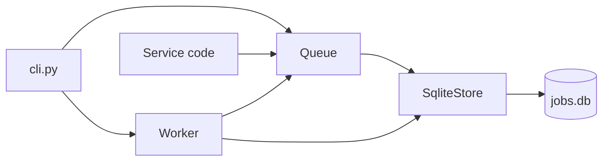

# Architecture

1. `Queue.enqueue` inserts a queued row via `SqliteStore.insert`.
2. `Worker.run_once` claims the oldest queued row (`claim_next` marks it running and bumps attempts).
3. The worker runs the registered handler and sets the status to done, back to queued, or failed after 3 attempts.

## Things to know

- The claim is a SELECT then an UPDATE, so running two workers on one database can process a job twice.
- A job whose name has no handler raises KeyError and stops the worker loop.
- Handlers live in memory, so the worker process must import the code that registers them.
