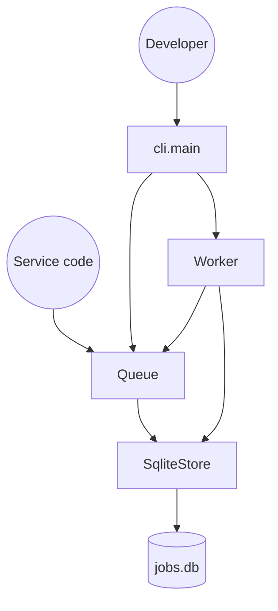

# Architecture

shipq has one piece of state: the `jobs` table in a SQLite file. Jobs enter through `Queue.enqueue` (from the CLI or from library code) and leave when a Worker marks them done or failed. Handlers live in memory on the Queue, so the process running the Worker must register every handler before it starts.

## Components

- **Queue**: registry of handlers and the enqueue call. See [`modules/queue.md`](modules/queue.md).
- **Worker**: claims and runs jobs, decides retries. See [`modules/worker.md`](modules/worker.md).
- **SqliteStore**: all SQL. See [`modules/storage.md`](modules/storage.md).
- **CLI**: argparse front end. See [`modules/cli.md`](modules/cli.md).

## System Diagram

## Data Flow

1. **Enqueue**: `Queue.enqueue` calls `SqliteStore.insert`, which writes a queued row. `shipq/queue.py`
2. **Claim**: `Worker.run_once` calls `SqliteStore.claim_next`, which marks the oldest queued row running and bumps attempts. `shipq/storage.py`
3. **Run and record**: the worker runs the handler and sets done, or queued again, or failed after 3 attempts. `shipq/worker.py`

## Key Design Decisions

- One SQLite file, no broker: simple to run, but only one worker process can safely claim at a time (the claim is a SELECT then an UPDATE, not atomic).
- Unknown job names raise KeyError in the worker before the try block, so they crash the loop rather than failing the job.
