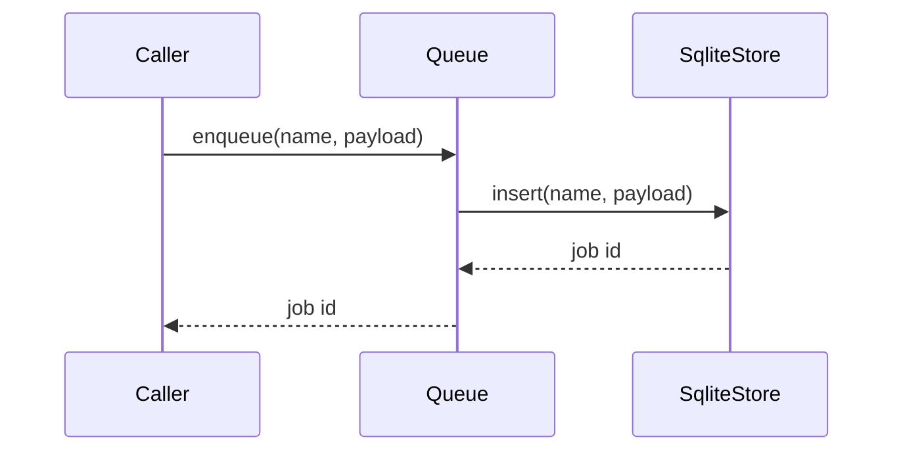
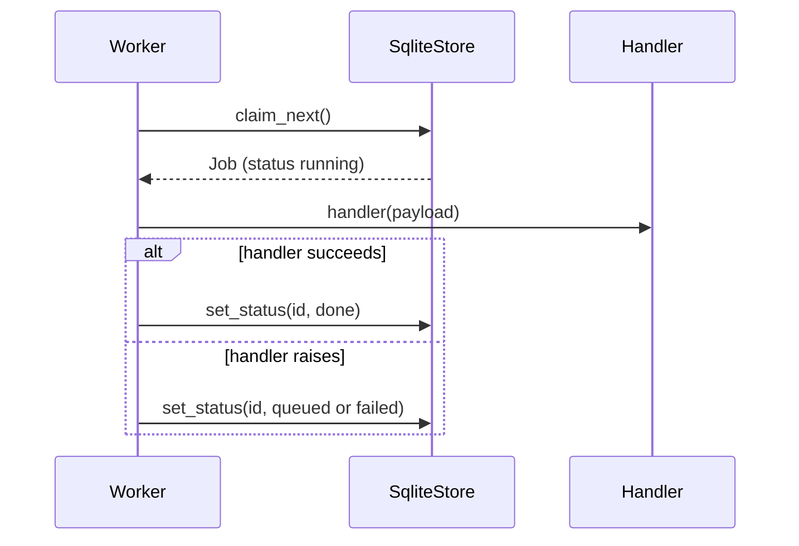

# Sequence Diagrams

## Workflow: Enqueue a job

Runs when service code or the CLI adds work.

## Workflow: Process one job

Runs on every iteration of the worker loop.

### Walkthrough

1. **Claim**: `storage.py:SqliteStore.claim_next`
2. **Run and record**: `worker.py:Worker.run_once`
